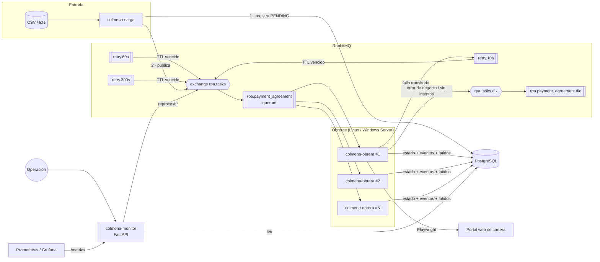
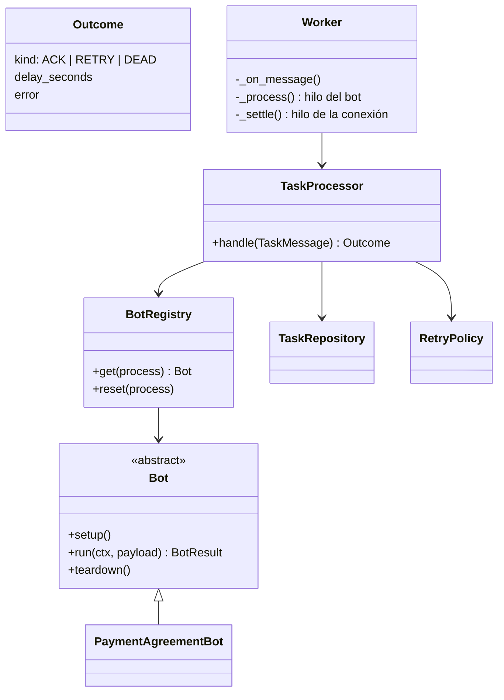
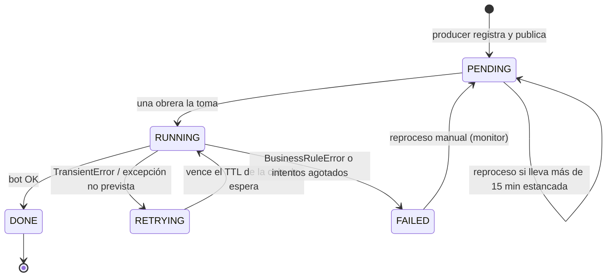
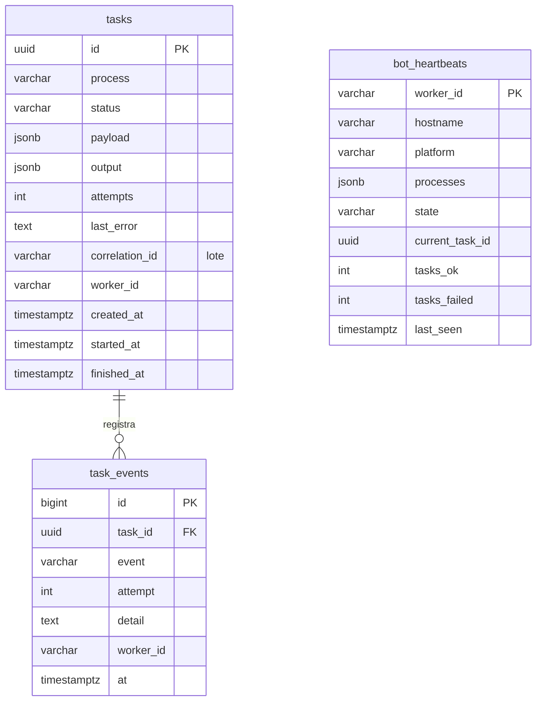

# Arquitectura

Este documento describe cómo está construida Colmena RPA, por qué cada pieza existe y qué
garantías ofrece. Las decisiones puntuales están registradas como [ADRs](adr/).

## 1. Contexto

En operaciones de gestión de cartera, muchas tareas se hacen sobre aplicativos web sin API
(registrar acuerdos de pago, actualizar gestiones, descargar soportes). Un bot RPA puede
hacerlas, pero un bot aislado no escala, no sobrevive a caídas del aplicativo y no deja rastro
consultable. La plataforma resuelve tres problemas:

1. **Distribuir la carga**: N bots en servidores Windows y Linux toman trabajo de una cola común.
2. **Tolerar fallas**: los errores transitorios se reintentan con espera creciente; los de negocio
   no se reintentan y quedan para revisión.
3. **Ver qué pasa**: cada tarea tiene estado y bitácora en PostgreSQL; cada bot reporta latidos;
   un panel de operación y métricas Prometheus centralizan el monitoreo.

## 2. Componentes

| Componente | Responsabilidad | Escala |
|---|---|---|
| `colmena-carga` | Lee archivos de entrada, asigna `task_id` determinístico, registra y publica. | Bajo demanda (CLI / tarea programada). |
| RabbitMQ | Desacopla productores de bots; reparte carga; retiene mensajes ante caídas. | Cluster de 3 nodos con colas quorum en producción. |
| `colmena-obrera` | Consume, ejecuta el bot, decide el desenlace y confirma el mensaje. | Horizontal: más instancias = más capacidad. |
| PostgreSQL | Fuente de verdad del estado de tareas, bitácora de auditoría y latidos. | Vertical + réplicas de lectura para el monitor. |
| `colmena-monitor` | API REST, panel de operación, métricas Prometheus y reproceso manual. | Sin estado: varias instancias tras un balanceador. |
| Portal demo | Simula el aplicativo legado que el bot opera (incluye fallas 503 configurables). | Solo para desarrollo y demos. |

## 3. Diseño interno de la obrera (worker)

La obrera sigue una arquitectura de **puertos y adaptadores**: la lógica que decide qué hacer con
una tarea (`TaskProcessor`) no conoce RabbitMQ; recibe un `TaskMessage` y devuelve un `Outcome`.
El adaptador (`worker/runtime.py`) traduce ese `Outcome` a operaciones del broker.

Beneficios concretos:

- Toda la lógica de reintentos, idempotencia y clasificación de errores se prueba con
  SQLite en memoria y un bot de prueba (`tests/unit/test_processor.py`), en milisegundos.
- Cambiar de broker (p. ej. a Azure Service Bus) implica reescribir solo el adaptador.
- Agregar un proceso nuevo = una clase `Bot` + una línea en `bots/catalog.py`.

### Concurrencia

Las tareas RPA pueden durar minutos. `pika.BlockingConnection` no es *thread-safe* y, si su hilo
se bloquea, deja de enviar latidos AMQP y el broker corta la conexión. Por eso:

1. El callback de RabbitMQ solo encola el trabajo en un `ThreadPoolExecutor` de **un hilo**.
2. El bot corre en ese hilo (Playwright síncrono exige usarse siempre desde el mismo hilo).
3. El `ack` / reintento / DLQ regresa al hilo de la conexión con `add_callback_threadsafe`.

## 4. Ciclo de vida de una tarea

Cada transición inserta una fila en `task_events` (quién, cuándo, intento, detalle), lo que da
trazabilidad completa para auditoría y para soporte a negocio.

## 5. Modelo de datos

El esquema se versiona con **Alembic** (`alembic/versions`). Una prueba automática verifica que
la migración produce exactamente el esquema declarado en código.

## 6. Garantías y modos de falla

| Situación | Qué pasa | Mecanismo |
|---|---|---|
| El portal responde 503 o hay timeout | Se reintenta en 10 s, 60 s y 300 s | Colas de espera con TTL ([ADR-0002](adr/0002-reintentos-con-colas-ttl.md)) |
| Dato inválido / cliente inexistente | No se reintenta; queda `FAILED` y en la DLQ con el error | Clasificación de errores ([ADR-0004](adr/0004-clasificacion-de-errores-rpa.md)) |
| Una obrera muere a mitad de una tarea | RabbitMQ reentrega el mensaje a otra obrera | `ack` manual después de persistir |
| Se reentrega una tarea ya terminada | Se confirma sin ejecutar el bot | Reclamo atómico: `UPDATE … WHERE status NOT IN ('DONE','FAILED')` |
| Operación pulsa *Reprocesar* sobre una tarea pendiente reciente | Se rechaza (409): su mensaje aún está en la cola | Solo fallidas o pendientes con más de 15 min sin movimiento (`RPA_REQUEUE_PENDING_AFTER_SECONDS`) |
| Doble clic en *Reprocesar* | Se publica una sola vez | Guarda optimista sobre `status` + `updated_at` |
| PostgreSQL cae mientras una obrera procesa | El mensaje vuelve a la cola (`nack`) y la obrera queda libre | Captura de fallas de infraestructura en `worker/runtime.py` |
| El bot repite un registro en el portal | El portal devuelve la misma confirmación | Referencia idempotente = `task_id` ([ADR-0003](adr/0003-idempotencia-y-at-least-once.md)) |
| Se carga dos veces el mismo archivo | Las filas repetidas se omiten | `task_id` determinístico (hash del contenido) |
| RabbitMQ no está disponible | La obrera reintenta conectar con backoff exponencial (máx. 30 s) | Bucle de reconexión |
| Una obrera deja de reportar | El monitor la marca `OFFLINE` («Sin latido») a los 60 s y `rpa_bot_up` = 0 | Latidos ([ADR-0005](adr/0005-monitoreo-por-heartbeats.md)) |
| Mensaje con JSON inválido | Se rechaza sin reencolar y termina en la DLQ | `x-dead-letter-exchange` de la cola principal |
| Navegador colgado tras un error | Se destruye y se recrea el bot antes del siguiente intento | `BotRegistry.reset()` |

La semántica es **at-least-once**: ninguna tarea se pierde; los duplicados se neutralizan en
tres capas (estado final, referencia idempotente, `task_id` determinístico).

## 7. Observabilidad

- **Logs JSON** (structlog) con `task_id`, `process`, `attempt` en cada línea: se pueden filtrar
  en Loki, ELK o CloudWatch sin parseo adicional.
- **Métricas Prometheus** en `/metrics`: `rpa_tasks{process,status}`, `rpa_bot_up{worker}`,
  `rpa_task_duration_avg_seconds`.
- **Evidencias**: ante cualquier error el bot guarda una captura de pantalla en `artifacts/`.
- **Panel de operación** en `/`: indicadores, obreras, tareas filtrables, bitácora por tarea
  con resumen del acuerdo y reproceso.
- **Monitoreo dedicado**: [torre-de-control](https://github.com/DarwinMontiel/torre-de-control)
  lee las colas `rpa.*` de RabbitMQ y publica su estado en tiempo real por WebSocket. Los
  nombres de colas, exchange y métricas (`rpa.tasks`, `rpa_tasks`, `rpa_bot_up`) se
  mantuvieron tras el renombre a Colmena para no romper esa integración ni las alertas.

## 8. Seguridad

- Credenciales del portal solo por variables de entorno (nunca en código ni en mensajes).
- Contenedores con usuario sin privilegios (`uid 10001`); servicios systemd con
  `NoNewPrivileges` y `ProtectSystem`.
- El payload de la tarea no se registra en logs (solo identificadores).
- El monitor no expone credenciales y se publica detrás de un proxy (TLS + autenticación
  corporativa); ver [deployment.md](deployment.md).
